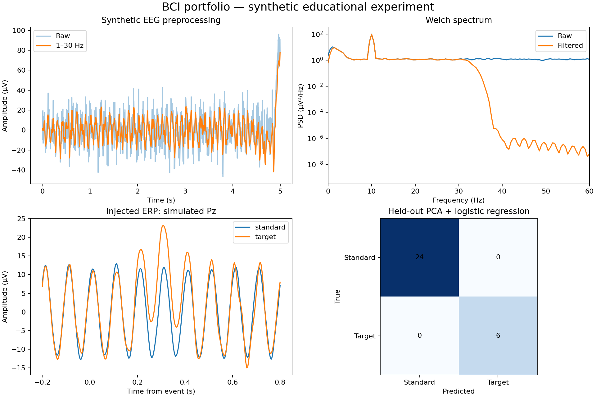
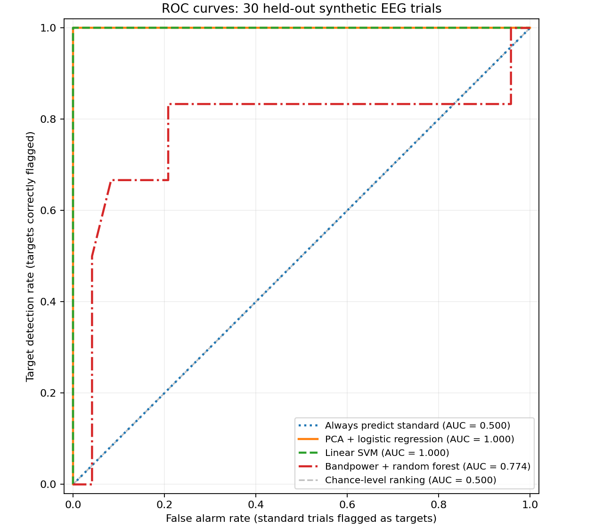

# EEG Signal Processing & Machine Learning

**Maher Sheikhi · BCI learning portfolio**

A practical Python project exploring how EEG-like signals move from preprocessing to event-related features and supervised classification. It builds on coursework labs and adds a reproducible, documented experiment for technical review.

**Start here:** [Portfolio report](REPORT.md) · [Measured results](results/RESULTS.md) · [Runnable pipeline](run_demo.py) · [Original labs](labs/)





Curves closer to the top-left corner detect more targets with fewer false alarms. Both time-based models reached AUC 1.000 on these 30 simulated test trials; the bandpower model reached 0.774, while the always-standard baseline scored 0.500 (chance-level ranking). These results describe deliberately simplified synthetic data, not real-world EEG performance. See the [plain-language results](results/RESULTS.md#results-in-plain-language) for details.

## Skills demonstrated

| Area | Evidence |
|---|---|
| Signal processing | MNE bandpass filtering, SciPy Welch PSD, integrated theta/alpha/beta bandpower |
| EEG analysis | Multichannel array handling, stimulus-aligned epochs, baseline correction, ERP averaging |
| Machine learning | Logistic regression, linear SVM, random forest, scaling and PCA within pipelines |
| Evaluation | Stratified holdout, training-only cross-validation, majority baseline, balanced accuracy, target F1, ROC AUC, shuffled-label control |
| Engineering | Seeded simulation, headless figures, machine-readable metrics, pinned environment, automated execution |

## Run the demonstration

Tested with Python 3.14.3. From the repository root:

```bash
python -m venv .venv
# Windows: .venv\Scripts\activate
# macOS/Linux: source .venv/bin/activate
python -m pip install -r requirements.txt
python run_demo.py
```

The command regenerates `results/metrics.json`, `results/RESULTS.md`, `results/overview.png`, and `results/roc_curve.png`. The [results page](results/RESULTS.md) includes a ROC comparison and a plain-language explanation of the findings. It uses simulated data only, needs no EEG hardware or external dataset, and opens no plot windows.

## Method at a glance


This is an **educational simulation**, not a clinical system or a validated human P300 detector. The simulator deliberately injects a target response. Its scores demonstrate pipeline behavior on that simulator, not real-world brain decoding performance.

## Repository contents

- `labs/`: preserved source labs; historical educational scripts with limitations described in the report.
- `run_demo.py`: new reproducible portfolio experiment; independent of the labs' import-time execution.
- `REPORT.md`: employer-facing technical narrative and evidence map.
- `results/`: committed outputs from an actual local run.
- `.github/workflows/demo.yml`: reproduces the experiment and uploads outputs.

## Provenance

The starting point is a set of local labs from BCI coursework. The portfolio restructuring, demonstration pipeline, and report were prepared with AI assistance. The original scripts remain unchanged for traceability. No claim of original neuroscience research, professional deployment, or independent authorship of course material is made. Existing recordings and serialized models are excluded. Redistribution rights for coursework should be checked before reusing it beyond this portfolio.
