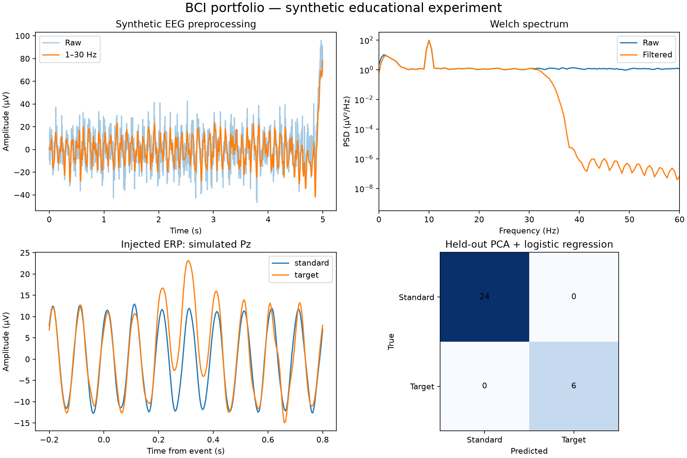

# Technical Portfolio Report

**Maher Sheikhi — EEG Signal Processing and Machine Learning**  
Prepared 12 November 2026

## Project overview

This learning project explores a brain-computer interface analysis workflow using Python: represent multichannel EEG, filter signals, inspect their frequency content, align data to events, extract features, and evaluate classifiers. The portfolio preserves the starting coursework scripts and provides a separate reproducible experiment that a reviewer can run without hardware or private data.

The practical outcome is a documented software demonstration, with saved plots and measured model metrics. It establishes hands-on exposure to BCI analysis tools and machine-learning evaluation. It does not establish clinical effectiveness or performance on human recordings.

## Evidence of practical experience

| Competency | Starting source | What the source actually shows |
|---|---|---|
| Synthetic EEG | `labs/simulate_eeg.py` | Four channels with a 10 Hz oscillation and additive noise at 250 Hz |
| Preprocessing and frequency analysis | `labs/lab2.py` | CSV loading, sample-rate estimation, 1–40 Hz FIR filtering, Welch PSD, visualization |
| ICA exploration | `labs/lab3.py` | Simulated blink transients, filtering, notch filtering, ICA fitting and application |
| Event-related analysis | `labs/lab4.py` | Standard/target events, −200 to +800 ms epochs, baseline correction, ERP averages |
| Classification | `labs/lab5.py` | Flattened features, bandpower exploration, PCA exploration, logistic regression, SVM, random forest, evaluation and serialization |

These are coursework examples, rather than evidence of production deployment. Their limitations are discussed below to make the scope of experience clear.

## Reproducible portfolio experiment

The new `run_demo.py` generates 180 seconds of four-channel synthetic EEG at 250 Hz. It combines alpha oscillations with noise, adds three blink-like transients, and deliberately injects a positive response around 300 ms after selected target events. A fixed random seed controls data generation, target assignment, splitting, and model randomness. Amplitudes passed to MNE are in volts; plotted values are converted to microvolts.

The processing chain applies a 1–30 Hz FIR filter, creates −200 to +800 ms epochs, and subtracts the −200 to 0 ms baseline. The channels are simulated labels, not measured electrode positions. Blink transients remain in this demonstration; it makes no claim of automated artifact removal.

Two feature representations illustrate different modeling choices. Flattened time samples retain the shape and latency of the synthetic ERP. Integrated Welch PSD features summarize theta (4–8 Hz), alpha (8–13 Hz), and beta (13–30 Hz) power per channel. Frequency bins use half-open intervals to avoid sharing boundary bins. Spectral features may discard information important for transient event responses; comparison is useful even when those features perform poorly.

A stratified 75/25 split reserves held-out trials. Five-fold stratified cross-validation operates on the training partition. Scaling and PCA are fitted inside scikit-learn pipelines, so neither learns from validation or test samples. The experiment compares fixed logistic regression, linear SVM, random forest, and a majority-class baseline. It reports accuracy, balanced accuracy, target F1, ROC AUC, and confusion matrices. The report does not choose hyperparameters from the holdout.

An additional training-only control permutes labels before cross-validating the temporal PCA/logistic pipeline. This checks whether performance deteriorates when the signal-label relationship is removed. One shuffled control is not a statistical permutation test.

## Measured results

See the generated [results table](results/RESULTS.md) and [full metrics and software versions](results/metrics.json). These files are generated by executing the code, rather than manually entering performance claims.

The majority baseline illustrates why accuracy alone can mislead when approximately 80% of trials are standards. Balanced accuracy gives equal weight to both class recalls, while target F1 exposes failure to detect the minority class. A strong score on injected synthetic responses verifies that this particular computational example is learnable; it is not evidence of successful decoding in a real participant.

## Review of the original labs

- The original event labels are randomly assigned to a signal without a corresponding target ERP. Classification scores from those labels should not be described as validated P300 detection.
- The ICA exclusion code is commented out. Fitting and applying ICA with no excluded components does not demonstrate blink-component removal.
- The original classifier variable is overwritten by successive models; the final evaluation and model export concern the random forest. The scripts do not provide a saved, fair comparison of all three models.
- The original PCA exploration is fitted before the split and is not used by the final classifier. Reusing those PCA features for evaluation would leak information. The new pipeline fits PCA inside each training fold.
- The lab bandpower helper averages selected PSD bins; the new example integrates PSD in V² and converts to µV² for numerically useful model inputs.
- The original synthetic amplitudes use arbitrary numeric scales passed to MNE. The new example specifies volts explicitly.
- Importing the original labs executes their simulation and analysis. The new demonstration has a main guard and runs independently.

## Scope and limitations

The simulator contains one synthetic recording and a deliberately simple response. Its regular event schedule also aligns with the synthetic alpha rhythm, which is visible in the ERP averages; it does not model natural trial timing variability. Trial-level splitting cannot measure generalization across participants, sessions, hardware, or noise environments. Filtering occurs before epoch splitting and is an offline, noncausal operation; this is not a benchmark of causal streaming performance. Epochs do not overlap, but shared recording structure remains a limitation. The evaluation sample is small, and cross-validation standard deviations are not confidence intervals.

There is no human-subject dataset, online BCI integration, clinical validation, or demonstrated real-time control. Original recording files are excluded because their source, units, and consent status are not established. The saved legacy pickle is excluded because its provenance and evaluation are not adequately documented.

The next useful extension is a documented public EEG dataset, with participant/session-aware splits, artifact quality checks, uncertainty estimates, and a final untouched test cohort. Automated artifact selection would require appropriate sensor information and inspection of excluded components.

## Suggested résumé wording

> Developed a coursework-based Python BCI portfolio covering EEG filtering, Welch spectral analysis, ERP epoching, and supervised classification with MNE, SciPy, and scikit-learn. Documented a reproducible synthetic-data experiment with leakage-aware preprocessing pipelines, stratified evaluation, class-imbalance baselines, and a shuffled-label control.

Use this wording after reviewing and running the project so you can explain its methods and limitations in an interview. The repository preparation and new demonstration used AI assistance; the preserved labs provide the starting evidence of learning work.
