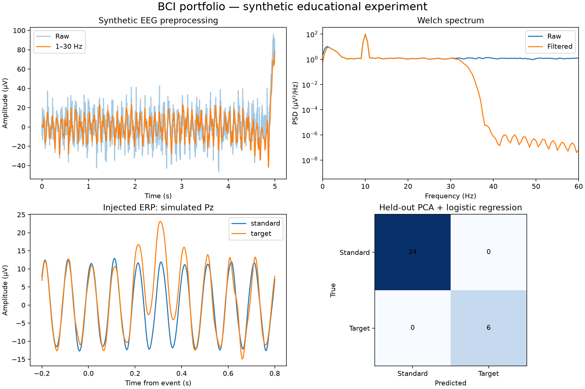

# Reproducible experiment results

All data are synthetic. Target ERPs are explicitly injected.

Seed 42; 119 trials (89 train / 30 test); class counts: {'1': 96, '2': 23}.

| Model | Accuracy | Balanced accuracy | Target F1 | ROC AUC | Train CV BA (mean ± SD) |
|---|---:|---:|---:|---:|---:|
| majority_baseline | 0.800 | 0.500 | 0.000 | 0.500 | 0.500 ± 0.000 |
| temporal_pca_logistic | 1.000 | 1.000 | 1.000 | 1.000 | 1.000 ± 0.000 |
| temporal_linear_svm | 1.000 | 1.000 | 1.000 | 1.000 | 0.942 ± 0.073 |
| bandpower_random_forest | 0.833 | 0.646 | 0.444 | 0.774 | 0.601 ± 0.121 |

Shuffled-label training CV balanced accuracy: 0.450 ± 0.095. This is a single negative control, not a permutation significance test.

Models and hyperparameters were fixed before evaluation. CV uses only the training partition. The holdout compares these fixed baselines; it should not be reused for tuning. These results assess this simulator only, not performance on human EEG.

