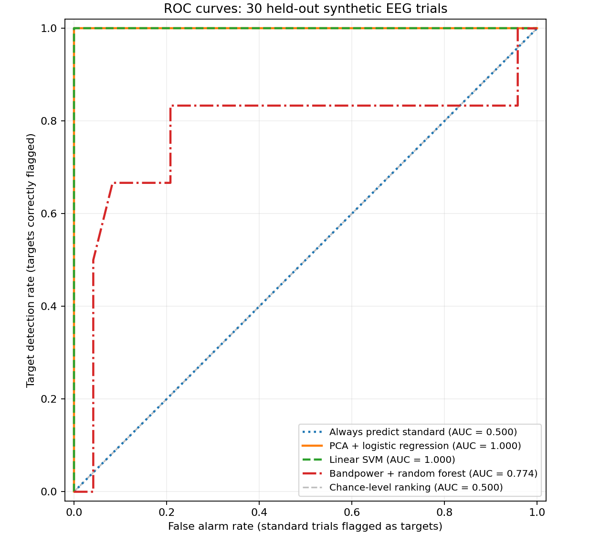

# Reproducible experiment results

All data are synthetic. Target ERPs are explicitly injected.

Seed 42; 119 trials (89 train / 30 test); class counts: {'1': 96, '2': 23}.

| Model | Accuracy | Balanced accuracy | Target F1 | ROC AUC | Train CV BA (mean ± SD) |
|---|---:|---:|---:|---:|---:|
| majority_baseline | 0.800 | 0.500 | 0.000 | 0.500 | 0.500 ± 0.000 |
| temporal_pca_logistic | 1.000 | 1.000 | 1.000 | 1.000 | 1.000 ± 0.000 |
| temporal_linear_svm | 1.000 | 1.000 | 1.000 | 1.000 | 0.942 ± 0.073 |
| bandpower_random_forest | 0.833 | 0.646 | 0.444 | 0.774 | 0.601 ± 0.121 |

Shuffled-label training CV balanced accuracy: 0.450 ± 0.095. This is a single negative control, not a permutation significance test.

Models and hyperparameters were fixed before evaluation. CV uses only the training partition. The holdout compares these fixed baselines; it should not be reused for tuning. These results assess this simulator only, not performance on human EEG.

## Results in plain language

The PCA + logistic regression model correctly classified all 30 test trials (6 targets and 24 standard events); the linear SVM also achieved 100% accuracy. Always guessing 'standard' achieved 80% accuracy because most events were standard, but it missed every target. The bandpower model achieved 83% accuracy and missed some targets, suggesting that the signal's shape over time was more useful here than its frequency summary. These strong scores come from a small, deliberately simplified simulation and do not show how well the models would work on real people.

## Reading the ROC curve

Each curve shows the trade-off as we change how easily a model flags an event as a target: moving upward means finding more targets, while moving right means raising more false alarms. Curves closer to the top-left corner are better; AUC summarizes this ranking ability (1.0 means perfect separation on these test trials, while 0.5 means chance-level ranking). The two time-based models both reached AUC 1.000 and overlap on this chart; the bandpower model reached 0.774, and the always-standard baseline lies on the chance diagonal.

